<!-- Panels are generated by assets/build.py in the portfolio's terminal style -->

  

  

  <a href="https://zahintapadar.github.io/"></a>
  <a href="https://zahintapadar.github.io/blog/"></a>
  <a href="https://www.linkedin.com/in/zahin-tapadar-524640243/"></a>
  <a href="mailto:zahintapadar@gmail.com"></a>

  

  <a href="https://atlasmac.web.app/"></a>
  <a href="https://zahintapadar.github.io/schwarzschild-lab/"></a>
  <a href="https://zahintapadar.github.io/wortraum/"></a>

  <a href="https://zahintapadar.github.io/blog/"></a>

  

  

